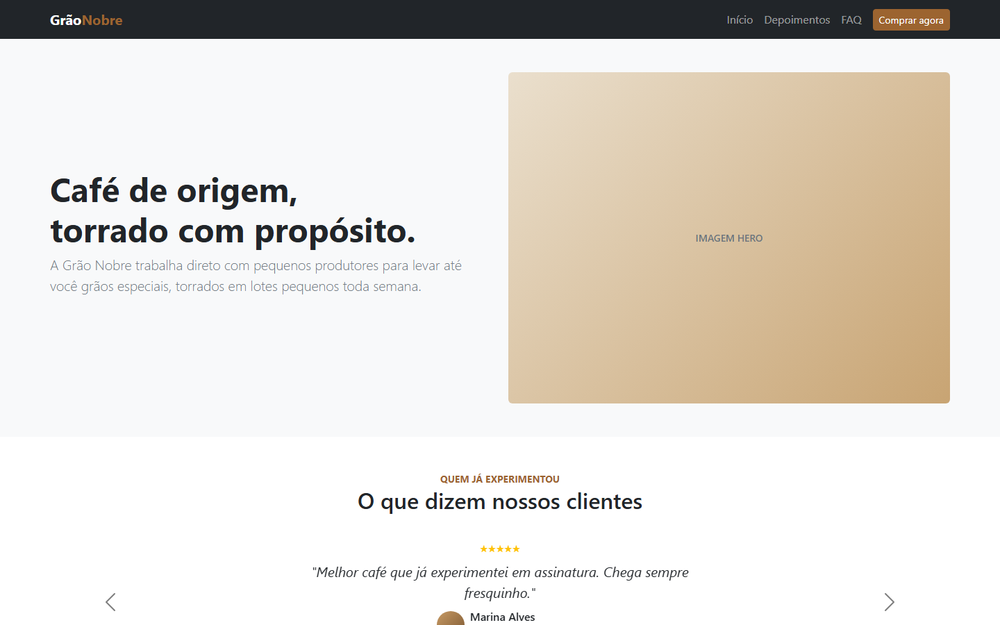
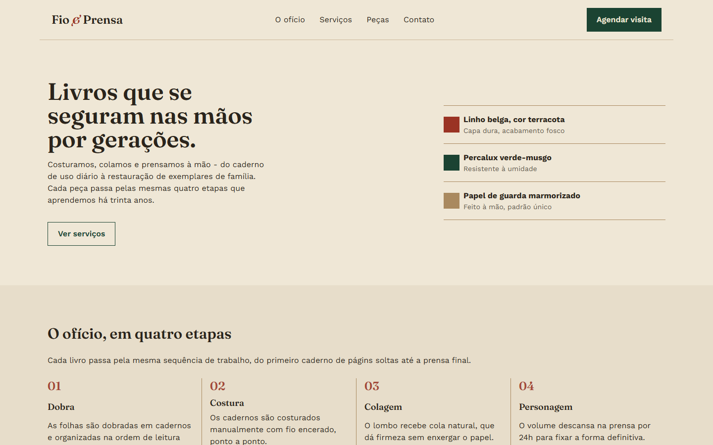
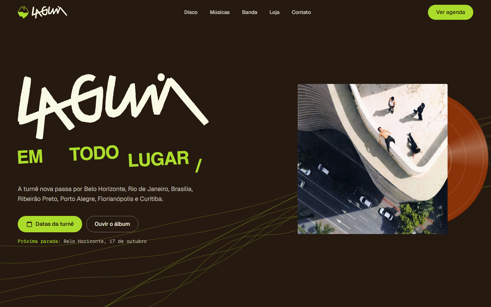

# CP5 - Front-end

Projetos do Checkpoint 5 de Front-end (FIAP, 1ESP).

| Projeto | Tecnologia | Link |
| --- | --- | --- |
| Grão Nobre | Bootstrap | [ericknathan.github.io/cp5-frontend/bootstrap](https://ericknathan.github.io/cp5-frontend/bootstrap) |
| Fio & Prensa | Tailwind CSS | [ericknathan.github.io/cp5-frontend/tailwind](https://ericknathan.github.io/cp5-frontend/tailwind) |
| Lagum | Vibe coding (HTML, Tailwind CSS e JavaScript) | [ericknathan.github.io/cp5-frontend/vibecoding](https://ericknathan.github.io/cp5-frontend/vibecoding) |
| NovaCore | Revisão (HTML e CSS) | [ericknathan.github.io/cp5-frontend/revisao](https://ericknathan.github.io/cp5-frontend/revisao) |

## Prints

### Grão Nobre (Bootstrap)

### Fio & Prensa (Tailwind CSS)

### Lagum (Vibe coding)

### NovaCore (Revisão)

## Estrutura

- [`bootstrap/`](bootstrap): landing page da Grão Nobre, feita com componentes do Bootstrap (navbar, modal, carrossel e accordion).
- [`tailwind/`](tailwind): site do ateliê de encadernação Fio & Prensa, feito com Tailwind CSS.
- [`vibecoding/`](vibecoding): novo site da banda Lagum, construído com IA. Os prompts usados estão em [`vibecoding/PROMPTS.md`](vibecoding/PROMPTS.md).
- [`revisao/`](revisao): landing page da empresa de tecnologia NovaCore, feita com HTML e CSS puro como revisão para o checkpoint.
